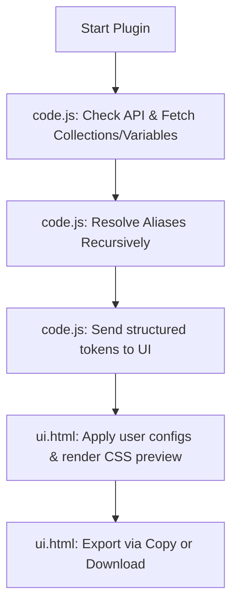

# Token → CSS Exporter Pro — Technical Documentation

`Token → CSS Exporter Pro` is a lightweight, high-performance Figma plugin designed to transform local Figma variables (Design Tokens) into clean, production-ready CSS custom properties.

---

## 🛠️ Tech Stack

The plugin is built using native Figma plugin architecture with a clean separation of concerns, utilizing web standards without heavy frameworks or build steps:

1. **Figma Plugin API (v1.0.0)**
   - Utilizes `getLocalVariableCollectionsAsync` and `getLocalVariablesAsync` to retrieve design tokens.
   - Accesses Figma's secure runtime sandbox to interact with the design document.

2. **Backend (Plugin Context — Sandbox)**
   - **File**: [`code.js`](file:///c:/Users/admin/Downloads/TokenPress/code.js)
   - **Environment**: Runs inside Figma's sandboxed JS environment.
   - **Purpose**: Direct interaction with the Figma API, variable retrieval, recursive alias resolution, and message passing.

3. **Frontend (UI Context — Iframe)**
   - **File**: [`ui.html`](file:///c:/Users/admin/Downloads/TokenPress/ui.html)
   - **Environment**: Runs inside a browser-like `<iframe>` within the Figma UI.
   - **Purpose**: Configuration UI, real-time CSS generation, selective collection filtering, preview, clipboard copying, and file downloading.
   - **Styling**: Modern, premium dark-mode interface built using Vanilla CSS custom properties and smooth transitions.

4. **Inter-Process Communication**
   - Employs Figma's native message passing system (`parent.postMessage` and `figma.ui.postMessage`) to send data and trigger actions between the plugin sandbox and UI.

---

## 🔄 How It Works

The workflow of the plugin consists of four main phases:

### 1. Variable Fetching
Upon launch, `code.js` queries Figma for collections and variables:
* **Defensive Guards**: Checks if variable APIs exist to handle legacy Figma environments gracefully without throwing uncaught errors.
* **Filtering**: Automatically excludes private design variables (any variable path segment starting with `.` or `_`).

### 2. Recursive Alias Resolution
When variables reference other variables (alias chains), `code.js` resolves them recursively using `figma.variables.getVariableByIdAsync` until a raw value (e.g., color, float, boolean) is reached. It returns the resolved value along with its original variable name and collection mapping so that reference names can be output as `var(...)` in CSS.

### 3. CSS Formatting & Real-Time Preview
The UI receives structured token data and runs formatting logic instantly on any user input changes:
* **Unit Mapping**: Converts raw numbers to `px` values while ignoring unit-less properties (like `opacity`, `line-height`, `z-index`, `font-weight`, `scale`, and `alpha`).
* **Name Sanitization**: Converts variable paths (e.g., `Brand / Primary / Main`) into standard kebab-case CSS custom properties (e.g., `--brand-primary-main`).
* **Simplification**: Automatically strips redundant namespace folder words (e.g., `colors`, `spacing`) when the "Simplify Names" setting is enabled.
* **Smart Mode Diffing (Themes)**: The first mode of a collection serves as the baseline (loaded in `:root`). Any additional modes (e.g., "Dark") are exported under `[data-theme="ThemeName"]` blocks. Crucially, the plugin compares values and **only** exports variables that differ from the baseline mode in that specific theme, resulting in compact override blocks.

### 4. Direct Action
Users can filter active collections via interactive chips, choose between a readable/indented representation (Pretty Print) or a minified block format, and then copy the CSS stylesheet to the clipboard or download it as a `.css` file.

---

## 🌟 Benefits

* **Automated Syncing**: Bridges the gap between designers and developers by establishing Figma variables as a single source of truth for UI CSS styles.
* **Instant Conversion**: Removes the need to manually copy values, type color codes, or calculate pixel properties.
* **Theme Optimization**: Reduces CSS bundle bloat by avoiding full duplication of all tokens in theme blocks, outputting only modified override tokens.
* **Clean Code output**: Safely ignores system-only or draft variables (marked private with `.` or `_`), outputting a production-ready stylesheet.

---

## ⚡ Key Advantages

* **High Performance**: Parses hundreds of tokens and re-generates CSS previews instantly on the client side without network overhead or latency.
* **Zero Dependencies**: Pure Javascript, HTML, and CSS. No `node_modules`, build processes, or external bundlers needed, making the plugin trivial to maintain.
* **Highly Customizable**: Developers can define custom global prefixes, choose to include/exclude metadata headers, toggle unit-appending, and easily scope selectors.
* **Fault-Tolerant**: Includes error handling boundaries for older Figma clients and missing library reference assets, ensuring the UI remains active and descriptive.
